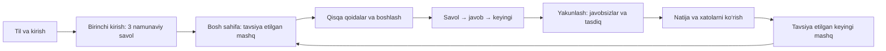

# Huqıq Mektebi — UX tahlili va soddalashtirish rejasi

Sana: 2026-10-06. Holat: audit 2026-10-06 kuni tuzilgan; frontend UX o‘zgarishlari 2026-10-11 kuni joriy etilgan.

## Frontendda bajarilgan ishlar (2026-10-11)

- Yangi foydalanuvchi uchun oldindan to‘ldirilgan tarix, davom etayotgan test va profil avtomatik yaratish to‘xtatildi. Avvalgi brauzer ma’lumotlari saqlanadi.
- Bosh sahifada birinchi qadam, uchta haqiqiy savolli interaktiv tanishuv, mashq va vaqtli sinov yo‘llari ajratildi. Natija va saqlangan savollar haqiqiy mahalliy holatga qarab ko‘rsatiladi.
- Testlar ro‘yxatida filtrlar tartiblandi, URLda tanlov saqlanadi, uch tildagi ko‘rinadigan nomlar orqali qidiriladi. Kartalarda test turi, mavzu, savol soni, vaqt va aniq harakat ko‘rsatiladi.
- Test boshlash sahifasida rejimni qayta tanlash olib tashlandi; savol tarkibi haqiqiy tartibga bog‘lanmaydi. Kontent hali to‘liq bo‘lmagan testlar interfeys namunasi deb belgilandi.
- Test yechishda mashq javobini alohida tekshirish, tanlovni tozalash, savollar xaritasi, ko‘rinadigan yakunlash, chiqishni tasdiqlash, matnni kattalashtirish va javoblar tomon o‘tish qo‘shildi. Progress berilgan javoblar sonini ko‘rsatadi.
- Natijada xatolarni ko‘rib chiqish asosiy harakat bo‘ldi, yozma javoblar kutayotgan ball dastlabki natija deb belgilandi. Xatolar sahifasida mahalliy qayta yechish oqimi qo‘shildi; dinamika test turi bo‘yicha filtrlanadi.
- Profilning talaba uchun keraksiz texnik havolalari olib tashlandi. O‘qituvchi bankidagi tafsilot oynasi dastlab yopiq, javob kaliti bitta radio tanlov sifatida ko‘rsatiladi.
- Kirish ekranidagi haqiqiy SMS yoki Telegram yuborilayotgandek ko‘rinadigan harakatlar mahalliy demo ma’lumotiga moslandi.
- O‘qituvchi uchun test tuzish to‘rt bosqichga ajratildi; savol muharririda formatlash vositalari yig‘ildi, importning namunaviyligi aniq yozildi, baholashda oxirgi tanlovni qaytarish qo‘shildi. Tahlildagi o‘zgartirishlar faqat mahalliy namuna ekanligi ko‘rsatildi.
- Yakuniy bahosi kutilayotgan urinishlar dinamika grafigi va o‘rtacha ballga qo‘shilmaydi; ro‘yxatda dastlabki natija deb ko‘rsatiladi.

Hali qolgan ishlar: savollar bankidagi to‘liq huquqiy kontent, haqiqiy baholash va foydalanuvchi ma’lumotlari backendga bog‘liq. Yangi talabalar bilan foydalanish tadqiqoti ham alohida o‘tkazilishi kerak. Ushbu auditdagi boshlang‘ich ekran tavsiflari 2026-10-06 kungi holatni qayd etadi.

## Xulosa

Yangi o‘quvchi uchun asosiy yo‘l yetarlicha tushunarli emas. Birinchi kirishdayoq tarix, tugallanmagan imtihon, muddatlar, mavzu statistikasi va bir nechta harakat ko‘rsatiladi. Testga kirganda menyu va boshqaruv joylashuvi almashadi. Natijadan keyingi tavsiya etilgan qadam esa aniq ko‘rsatilmaydi.

Eng avval uch tildagi matnlar va qidiruvni to‘g‘rilash, yangi foydalanuvchi holatini yaratish, test yechish boshqaruvlarini tushunarli qilish kerak. Ko‘zga qulaylik ishlari shu yo‘l bilan birga bajariladi.

## Tahlil qanday bajarildi

- Codex side brauzerini boshqarish vositasi ushbu sessiyada ulanmagan. Foydalanuvchi roziligidan keyin ishlayotgan `http://localhost:5173` sayt mahalliy Chromium orqali ko‘rildi.
- Alohida brauzer kontekstlari ishlatildi. Foydalanuvchining ochiq brauzeridagi ma’lumot va sozlamalar o‘zgartirilmadi.
- 19 asosiy sahifa turi ko‘rildi; kirish → mashq → variant tanlash → savollar xaritasi → topshirish → natija → javob tahlili yo‘li amalda bosib o‘tildi.
- Sinov imtihoni, yozma javob, offline xabari, kutayotgan baho, uch til, yorug‘ va qorong‘i rejimlar ko‘rildi. Oyna o‘lchamlari: 1440×900, 1366×768, 1024×768.
- Importning yuklash, tekshirish va e’lon qilishga tayyorlash ekranlari ko‘rildi. Namunaviy fayl mavjud demo ekranlarini ochish uchun ishlatildi; haqiqiy Excel o‘qilishi tekshirilgani emas.
- Kuzatuvlar kod bilan solishtirildi. Bu ekspert tahlili; haqiqiy boshlovchi talabalar bilan foydalanish tadqiqoti hali o‘tkazilmadi. Adashish xavfi haqidagi xulosalar kuzatilgan interfeysga asoslangan bahodir.
- Dalillar: `browser-observations.json` va `screenshots/`. JSONdagi ayrim nomlar kutilgan holatni bildiradi: haqiqiy kutayotgan baho `37-results-awaiting-teacher`, yozma savol `35-practice-written-actual-q4`. Yangi kirish `43-first-login-dashboard`da alohida toza kontekstda qayta ko‘rildi.

## Ko‘rilgan sahifalar

| № | Sahifa / yo‘l | Kuzatilgan asosiy holat |
|---|---|---|
| 1 | Kirish — `/sign-in` | Telefon, 6 xonali kod, demo kirish. Sodda forma; maqsad matni umumiy. |
| 2 | Bosh sahifa — `/` | Yangi kirishda ham Aybek, 11-B, 10 ta urinish, 3 ta xato, 12-savolda davom ettirish. |
| 3 | Testlar — `/tests` | Tur va mavzu filtrlari, kartalar, qidiruv. Mahalliy tildagi nom bilan qidirish ishlamaydi. |
| 4 | Boshlash — `/tests/:testId` | Takroriy rejim tanlash, ikki ustundagi qoidalar, pastdagi alohida boshlash paneli. |
| 5 | Test — `/exam/:testId` | Variantli va yozma savollar, taymer, xarita, topshirish oynasi, offline holati. |
| 6 | Natija — `/results/:attemptId` | Ball, mavzular, savollar ro‘yxati, kutayotgan yozma baho. |
| 7 | Javob tahlili — `/results/:attemptId/q/:n` | Savol va javob, natijaga qaytish, oldingi/keyingi, xatolarimga qo‘shish. |
| 8 | Xatolarim — `/mistakes` | Savollarni ochib to‘g‘ri javobni ko‘rish. Qayta yechish jarayoni yo‘q. |
| 9 | Dinamika — `/progress` | Grafik, urinishlar, umumiy foizlar. Ayrim demo tarix qatorlari ochilmaydi. |
| 10 | Profil — `/profile` | Til, rang rejimi, shaffoflik, o‘qituvchi paneli, dizayn tizimi, demo tiklash. |
| 11 | O‘qituvchi bosh sahifa — `/admin` | Ko‘p statistika, baholash navbati, muammoli savollar va topshiriqlar. |
| 12 | Savollar banki — `/admin/bank` | Zich jadval va dastlabdan ochiq savol ko‘rinishi. |
| 13 | Savol muharriri — `/admin/editor/:id?` | Mavjud va yangi savol; variantli/yozma shakl; Markdown, ko‘rinish, saqlash. |
| 14 | Import — `/admin/import` | 3 bosqich, xatolar va takror savollar bo‘yicha qarorlar. |
| 15 | Test tuzish — `/admin/builder` | Bir vaqtda sozlamalar, savollar rejasi, guruhlar; qo‘lda tanlash ham ko‘rildi. |
| 16 | Baholash — `/admin/grading` | Javoblarni solishtirish, uch baho, navbat, qisqa klaviatura buyruqlari. |
| 17 | O‘quvchilar — `/admin/students` | O‘quvchi ro‘yxati va yonma-yon statistik tafsilotlar. |
| 18 | Tahlil — `/admin/analytics` | Jadval, variantlar ulushi, koeffitsiyentlar, qayta baholash harakati. |
| 19 | Dizayn tizimi — `/design` | Ranglar, shriftlar, komponentlar va ichki texnik yozuvlar. |

## Aniq muammolar va yechimlar

P0 — asosiy vazifani tushunish yoki ishonchli bajarishga to‘siq. P1 — boshlovchi foydalanuvchini chalg‘itadigan muhim holat. P2 — keyingi soddalashtirish va sayqallash.

| ID | Ustuvorlik | Kuzatuv va ta’sir | Taklif | Dalil |
|---|---|---|---|---|
| UX-01 | P0 | O‘zbek, qoraqalpoq va rus rejimlarida boshlash qoidalari inglizcha bilan aralash: “Real timer. Natijalar at the end…”. Qoidani anglash qiyin. | To‘liq gaplarni har til uchun yozish. So‘zma-so‘z fallback tarjimani olib tashlash; dinamik son, vaqt va sanalarni ham mahalliylashtirish. | `03-lobby`, `15-lobby-ru`, `16-lobby-kaa` |
| UX-02 | P0 | “Sinov” qidiruvi test topmaydi, “Mock” topadi. Ko‘rinadigan nom bilan qidiruv ma’lumoti mos emas. | Qidiruvni ko‘rinadigan tarjima nomlari, mavzular va barcha uch tildagi muqobil nomlarga bog‘lash. Filtrlarni tozalash tugmasi qo‘shish. | `28-search-uz`, `29-search-en`; `Catalog.tsx` |
| UX-03 | P0 | Toza kirishda ham boshqa shaxsning ismi, guruh va tarix chiqadi. “Davom ettirish” birinchi vazifa bo‘lib qoladi. | Yangi foydalanuvchi holati: tarixsiz bosh sahifa, qisqa tanishtirish, asosiy “3 ta namunaviy savol bilan sinab ko‘rish” harakati. Demo tarixini alohida namuna rejimiga ko‘chirish. | `43-first-login-dashboard`; `AppState.tsx` |
| UX-04 | P0 | Mashqlar №1da qoidalar va xarita 6-savolni yozma deydi; amalda yozma savol 4-raqamda, 6-raqam variantli. | Qoidalar va xarita guruhlarini haqiqiy savol turlari/raqamlaridan hisoblash. Savol turi tartibli bo‘lishi shart deb taxmin qilmaslik. | `03-lobby`, `06-map`, `07-written`, `35-practice-written-actual-q4` |
| UX-05 | P0 | Savol va to‘g‘ri javob o‘rnida `[Question text…]`, `[Answer option A]` chiqadi. O‘quvchi mazmunni o‘rgana olmaydi. | Boshlovchi yo‘lida faqat to‘liq savol, variant va izohlar ishlatish. Tayyor bo‘lmagan to‘plamga “Tayyorlanmoqda” holati berish. | `07-written`, `10-review`, `12-mistake-expanded` |
| UX-06 | P1 | O‘quvchi profilidan o‘qituvchi paneli, ichki dizayn va demo tiklash ochiladi. Maqsadga aloqasiz yo‘llar ko‘payadi. | O‘quvchi navigatsiyasida faqat o‘qish vazifalarini qoldirish. Ichki dizayn/demo vositalarini ishlab chiqish rejimiga chiqarish. | `14-profile`, `44-first-login-profile` |
| UX-07 | P1 | Katalogda tanlangan test turi boshlash sahifasida qayta tanlanadi. “Mashq” to‘plamida “Sinov imtihoni” tanlansa ham vaqt limiti yo‘q. | Birinchi tanlov: “Mashq qilish” yoki “Sinov imtihoni”. Keyingi sahifada shu tartibni tushuntirish; ikkinchi tanlov faqat asosli holatda “Tartibni o‘zgartirish” orqali. | `03-lobby`; `Lobby.tsx` |
| UX-08 | P1 | Til tanlash va erta topshirish xarita oynasida. “X” chiqish belgisi ko‘rinishda izohsiz; taymer ketaveradi. | “Testni yakunlash”ni doim ko‘rinadigan joyga chiqarish. “Chiqish” matnli tugmasi va taymer davom etishini aytadigan dialog. Tilni testdan oldin aniq tanlash, testda topiladigan menyu. | `04-practice`, `06-map`, `17-mock-exam` |
| UX-09 | P1 | Yuqori progress joriy savol raqamini bildiradi: xaritadan oxirgi savolga o‘tilsa 6/6 to‘ladi, hatto bitta javob bo‘lsa ham. | “6-savol / 6” va “1 ta javob berildi / 6”ni alohida ko‘rsatish. Progress chizig‘ini javoblar soniga bog‘lash. | `08-submit`; `Exam.tsx` |
| UX-10 | P1 | Imtihonda tanlangan variantni yana bosish javobni o‘chiradi. Mashqda birinchi tanlov darhol qulflanadi. | Imtihonda takror bosish tanlovni saqlasin; o‘chirish alohida bo‘lsin. Mashqda “Javobni tekshirish” bosqichi va keyin izoh ko‘rsatish. | Brauzerda `aria-checked`: true → false; `Exam.tsx` |
| UX-11 | P1 | “Xatolarni mashq qilish” javoblar ro‘yxatini ochadi; qayta yechish yo‘q. | Alohida qayta yechish harakati; javobni oldindan ochmaslik. “Saqlangan savollar” va “Noto‘g‘ri javoblar” ma’nosini ajratish. | `12-mistake-expanded`; `Extras.tsx` |
| UX-12 | P1 | Natijada asosiy harakat “Tayyor”; kutayotgan yozma baho bo‘lsa ham katta foiz yakuniy ballga o‘xshaydi. | “Dastlabki natija” holati; baholangan va kutilayotgan qismlarni ajratish. Asosiy tugma “Xatolarni ko‘rib chiqish”, ikkilamchi “Bosh sahifaga”. | `09-results`, `37-results-awaiting-teacher` |
| UX-13 | P1 | Katta boshlash/davom ettirish tugmasi karta sarlavhasini siqadi; 69 va % alohida qatorga tushadi. Muhim matnlar bir necha bo‘lakda o‘qiladi. | Davom ettirish kartasida tugma pastki qatorda; uzun sarlavhaga to‘liq kenglik. Son va %ni birga ushlab turish. | `43-first-login-dashboard` |
| UX-14 | P1 | 1024×768 oynada uzun savolda variantlar pastda qoladi; suzuvchi pastki panel kontent ustidan o‘tadi. “Keyingi”ni javoblarni ko‘rmasdan bosish mumkin. | Savol va variantlarni bir o‘qish yo‘liga keltirish; “Variantlar pastda” ko‘rsatkichi. Pastki panelga ajratilgan joy, pastga oson o‘tish, javobsiz keyingi savolga o‘tishda tushunarli holat. | `30-laptop-exam`, `33-compact-laptop` |
| UX-15 | P2 | Grafikda qiymatlar/sana o‘qlari yo‘q; mashq va imtihon natijalari bitta trendda. | Qisqa matnli izoh, sanalar va foizlar, test turiga ko‘ra filtr. To‘liq va kutilayotgan natijalarni alohida ko‘rsatish. | `13-progress`; `Extras.tsx` |
| UX-16 | P2 | O‘qituvchi sahifalarida zich jadvallar, avtomatik ochiq tafsilot, Markdown/Blueprint/discrimination kabi atamalar bor. | Oddiy nomlar, talab bo‘lganda ochiladigan tafsilot va murakkab sozlamalar; test tuzishni bosqichlarga ajratish. | `20-bank`, `21-editor`, `23-builder`, `26-analytics` |

Savol materiali hozir qoraqalpoq tilida qoladi. Bu aralash UI tarjimasi bilan bir xil muammo emas: interfeys tili va savol tili alohida ko‘rsatilishi kerak. Platforma materiallari ham uch tilda bo‘lishi rejalashtirilsa, har bir savol/variant/izoh uchun uch tildagi mazmun tayyorlash va mutaxassis tahriri alohida ish bandi bo‘ladi.

## Taklif etilgan o‘quvchi yo‘li

Tanishish mashqi o‘tkazib yuborilishi va keyin qayta ochilishi mumkin. Unda taymer, haqiqiy natijalar tarixiga ta’sir yoki majburiy uzoq tanishtirish bo‘lmaydi. Birinchi namunaviy savol tugmalar ishlashini, ikkinchisi javobni o‘zgartirishni, uchinchisi yozma javob/xaritani tushuntiradi.

O‘quvchi menyusi uchun taklif: **Bosh sahifa · Mashqlar va imtihonlar · Natijalarim · Xatolarim · Profil**. Har sahifada bitta asosiy vazifa va bitta asosiy tugma bo‘ladi. Test ichida global menyu qisqarishi mumkin, lekin “Chiqish”, joriy test va uning tartibi tushunarli qoladi.

## Sahifalarni qanday soddalashtiramiz

### Birinchi kirish va bosh sahifa

- Kirishda maqsadni bir gapda aytish: “Huquq sertifikati uchun test yeching va xatolaringizni o‘rganing.”
- Birinchi sahifada “Qanday ishlashini sinab ko‘rish”ni asosiy harakat qilish.
- Bosh sahifaning birinchi bloki foydalanuvchi holatiga mos: yangi → namunaviy mashq; faol test → davom ettirish; topshirgan → xatolarni ko‘rish.
- Yangi foydalanuvchida grafik, eng zaif mavzular, begona guruh va demo tarix chiqmasin. Shaxsiy tarix paydo bo‘lgach bu bloklar qo‘shiladi.
- Tavsiya etilgan bitta mashq, keyin o‘qituvchi topshirig‘i. Qolgan statistika “Natijalarim”da.

### Katalog va boshlash

- Dastlab ikkita tushunarli yo‘l: “O‘rganish uchun mashq” va “Vaqt bilan sinov imtihoni”.
- Test kartasida nom, savollar soni, vaqt/tartib va aniq “Boshlash” yoki “Davom ettirish” tugmasi.
- Barcha mavzu filtrlarini majburiy birinchi tanlov qilmaslik; qidiruv va filtrlash yordamchi vosita.
- Boshlash sahifasi: tanlangan test → savollar soni va tili → vaqt qoidasi → 3 qisqa ko‘rsatma → “Boshlash”.
- Klaviatura buyruqlari qo‘shimcha ochiladigan qismda. Sichqoncha bilan bajariladigan yo‘l mustaqil tushunarli bo‘lsin.

### Test yechish

- Savol va variantlar ko‘z bilan bitta yo‘nalishda kuzatiladigan qilib joylashtiriladi. Oddiy qisqa savolda bir ustun afzal; uzun moslashtirish savolida ikki ustun imkoniyati saqlanadi.
- Boshqaruv: **Oldingi · Keyingi savol · Keyin ko‘rish uchun belgilash · Testni yakunlash**. “Savollar” paneli alohida, oson topiladi.
- Keng oynada savollar panelini yon tomonda ochish mumkin; kichik laptopda matnli “Savollar” tugmasi orqali. Panelda til tanlash, topshirish va navigatsiyani bir joyga tiqmaslik.
- Tanlangan javob belgi, kontur va “Tanlandi” holati bilan ko‘rsatiladi. Rangning o‘zi ma’no tashimasin.
- Mashqda avval variant tanlash, keyin “Javobni tekshirish”; so‘ng to‘g‘ri javob va izoh; keyin “Keyingi savol”.
- Yozma javobda kutilayotgan formatga misol: “Atamani yozing” yoki “Bir jumlada javob bering”. Harflar paneliga “Qoraqalpoq harflari” nomi berish.
- Chiqishda: “Javoblar shu qurilmada saqlanadi. Imtihon taymeri davom etadi.” Ikki harakat: “Testga qaytish” va “Chiqish”.
- Saqlash holati haqiqiy imkoniyatni bildirsin: hozir “Shu qurilmada saqlandi”. Serverga saqlanganlikni bildiruvchi bulut belgisi bilan noto‘g‘ri taassurot bermaslik.

### Natija, tahlil va xatolar

- Natija tepasida tushunarli jumla: “6 savoldan 1 tasiga to‘g‘ri javob berdingiz.” To‘g‘ri, noto‘g‘ri, javobsiz va kutilayotgan bahoni ajratish.
- Kutayotgan bahoda “Dastlabki natija”; yakuniy ball kelguncha uning holati grafikda ham saqlanadi.
- Asosiy davom: “Xatolarni ko‘rib chiqish” → savol, sizning javobingiz, to‘g‘ri javob, qisqa sabab → keyingi xato.
- Javobsiz savolni noto‘g‘ri tanlangan javob bilan bir xil qizil xato sifatida tushuntirmaslik.
- “Xatolarim”da qayta yechish; foydalanuvchi javob bermaguncha to‘g‘ri javob yashiriladi. Saqlangan savolni olib tashlash ikkilamchi harakat bo‘ladi.
- “Natijalarim”ga tarix va trendni birlashtirish. Statistikaga qarab konkret navbatdagi mashq tavsiya etish.

### O‘qituvchi interfeysi

- Bosh sahifada eng zarur uch vazifa: baholash navbati, test biriktirish, savol qo‘shish.
- Savollar bankida tafsilot paneli savol tanlangandan keyin ochiladi. Jadvalning dastlabki ustunlari: savol, mavzu, tur, holat; qolganlari qo‘shimcha.
- Savol muharririda oddiy matn kiritish asosiy; Markdown tafsilotlarini alohida ochish. Yagona to‘g‘ri javob radio bilan tanlanishi mumkin — to‘rtta mustaqil switch taassurotini kamaytiradi.
- Test tuzish: **Tartib va nom → savollar → guruh va muddat → ko‘rib chiqish va biriktirish**.
- Importda muammo + sabab + keyingi amal har biri sodda mahalliy matnda. “Qatorni tahrirlash” Excelda tuzatishni anglatayotgan bo‘lsa, tugma nomi ham shuni aytsin.
- Baholashda tanlangan baho saqlanganini tasdiqlash va oxirgi amalni qaytarish imkoniyati. Butun guruhga qoida qo‘llashdan oldin ta’sirini ko‘rsatish.
- Tahlilda murakkab koeffitsiyentdan avval oddiy mazmun: “Bu savolning to‘g‘ri javobini tekshirish tavsiya etiladi.” Qayta baholashdan oldin nechta natija o‘zgarishini ko‘rsatish.

## Ko‘zga qulaylik talablari

Quyidagi qiymatlar boshlang‘ich dizayn takliflari; real o‘quvchilarning sinovidan keyin aniqlashtiriladi.

| Qism | Taklif |
|---|---|
| Savol va variant matni | 18 px atrofida; satr balandligi 1.5–1.6; matnni kattalashtirish boshqaruvi. |
| Muhim ko‘rsatma | 14–16 px; vaqt yoki topshirish qoidasi mayda kulrang footnote bo‘lmasin. |
| Matn kengligi | Uzun matnda taxminan 60–75 belgi; moslashtirish bloklarida boshqariladigan ustunlar. |
| Tugmalar | 44–48 px balandlik; ikona bilan birga aniq matn; har bo‘limda bitta asosiy urg‘u. |
| Fon | Test ekranida tinch, sodda fon; o‘qish maydonida bezak va shaffof qatlamlarni kamaytirish. |
| Statistik karta | Son va % bitta qator; uzun sarlavha uchun joy; tugma matn ustunini siqmasin. |
| Kontent va panel | Pastki boshqaruv uchun yetarli bo‘sh joy; uzun savol oxiri va variantlarga to‘siqsiz yetish. |
| Holatlar | To‘g‘ri = belgi + matn, xato = belgi + matn, javobsiz = neytral holat. |
| Fokus va klaviatura | Fokus ko‘rinadi; dialogdan qaytishda oldingi joyga qaytish; qisqa buyruqlar yozishda xalaqit bermaydi. |
| Laptop oynalari | 1440×900, 1366×768 va 1024×768da kontent va barcha muhim boshqaruvlar o‘qiladigan bo‘lishi. |

Bu reja desktop/laptop interfeysiga tegishli. Mobil mockup yaratish bandi yo‘q. Terms, Privacy va Help havolalari qaytarilmaydi. Foydalanish ko‘rsatmalari tegishli sahifa va amal yonida beriladi.

## Bajarish bosqichlari

| Bosqich | Ishlar | Tugallanganlik mezoni |
|---|---|---|
| 1. Tushunishga to‘sqinliklarni tuzatish | UX-01–05: uch til, qidiruv, toza yangi kirish, savol turlari va to‘liq demo mazmun. | Uch tilda kritik qoidalar aralashmasiz; ko‘rinadigan nom bilan test topiladi; yangi foydalanuvchida tarix yo‘q; xarita va haqiqiy savol turi mos. |
| 2. O‘quvchi yo‘lini soddalashtirish | Bosh sahifa, navigatsiya, 3 savolli tanishish, katalog va qisqa boshlash sahifasi. | Boshlovchi qo‘llanmasiz namuna mashqini topib, boshlashi mumkin; o‘quvchi panelida ichki dizayn/admin yo‘li yo‘q. |
| 3. Test va natija jarayoni | UX-08–12: boshqaruvlar, progress, javob tekshirish, yakunlash, chiqish, dastlabki natija, xatolarni qayta yechish. | Har holatda “qayerdaman, javob saqlandimi, keyin nima qilaman” aniq. Tanlov takror bosishda yo‘qolmaydi; “mashq” tugmasi haqiqiy qayta yechishni ochadi. |
| 4. O‘qish qulayligi | Shrift, karta kengligi, uzun savollar, grafiklar, yorug‘/qorong‘i rejim, laptop o‘lchamlari. | Muhim yozuvlar siqilmaydi; javob va boshqaruvlarga to‘siqsiz yetiladi; 69 % kabi qiymat bo‘linmaydi. |
| 5. O‘qituvchi interfeysi | Jadvallar, muharrir, test tuzish bosqichlari, import matnlari, baholash tasdiqlari. | Asosiy ish ketma-ket bajariladi; qo‘shimcha sozlama kerak bo‘lganda ochiladi; ta’sirli amal oldidan uning natijasi tushuntiriladi. |
| 6. Boshlovchilar bilan tekshirish | Quyidagi foydalanish sinovlari va topilgan muammolarni tuzatish. | Belgilangan maqsadlarga yetish; yordam talab qilgan nuqtalar qayta ishlanadi. |

Bosqichlar frontend va UX darajasida ishlab chiqiladi. Haqiqiy SMS, serverga saqlash yoki baholash integratsiyasi bu rejaning ish hajmiga kiritilmagan. Hozirgi demo imkoniyatlari uchun interfeysda ishonchli va aniq holatlar beriladi.

## Keyingi ishlab chiqish uchun fayllar

| Ish | Asosiy fayllar |
|---|---|
| Uch til va mahalliy format | `src/i18n/LanguageProvider.tsx`, `messages.ts`, `src/lib/format.ts`, `src/data/topics.ts` |
| Qidiruv va katalog | `src/pages/student/Catalog.tsx`, `src/lib/tests.ts`, `src/data/tests.ts` |
| Yangi foydalanuvchi va navigatsiya | `src/state/AppState.tsx`, `src/state/seed.ts`, `Dashboard.tsx`, `StudentShell.tsx`, `Extras.tsx` |
| Qoidalar va savol xaritasi | `Lobby.tsx`, `Exam.tsx`, `src/components/exam/parts.tsx` |
| Javoblar va natija | `Exam.tsx`, `Results.tsx`, `Review.tsx`, `Extras.tsx`, `src/lib/grading.ts` |
| Ko‘rinish va o‘qish | `src/styles/app.css`, `src/styles/hm.css`, umumiy UI komponentlari |
| O‘qituvchi jarayonlari | `src/pages/admin/*`, `src/components/layout/AdminShell.tsx` |

Tarjima JSX ichida aniq kalit va parametrlar orqali berilishi kerak. Ko‘rinadigan DOM matnlarini kuzatib so‘zlarni almashtirish qidiruv, grammatika va dinamik matnlar o‘rtasida tafovut hosil qilmoqda. Har til uchun son kelishiklari, vaqt va sana yozilishi ham ko‘rib chiqiladi.

## Rejani qabul qilish uchun foydalanish sinovi

Taklif: kompyuterda test yechmagan yoki juda kam yechgan kamida 5 o‘quvchi/abituriyent. Til tushunarliligini uch til vakillari bilan alohida tekshirish. Quyidagilar hozir bajarilgan tadqiqot natijasi emas, kelgusi maqsadlar.

1. Kirishdan keyin sayt vazifasini va boshlash joyini topish: asosiy harakatni 10 soniya ichida aniqlash.
2. Tanishish mashqini topish va boshlash: 30 soniya ichida, tashqi ko‘rsatmasiz.
3. Variant tanlash, uni o‘zgartirish va keyingi savolga o‘tish: tasodifiy o‘chirishsiz.
4. Savolni keyin ko‘rish uchun belgilash va unga qaytish.
5. Yozma javob kiritish; tegishli harf va format ko‘rsatmasini tushunish.
6. Javobsiz savollarni ko‘rib chiqish, so‘ng ongli ravishda topshirish.
7. Natijadan to‘g‘ri, noto‘g‘ri, javobsiz va hali baholanmagan javobni farqlash.
8. Xatosini ko‘rib chiqib, shu savolni qayta yechish.
9. O‘z tilidagi test nomi bilan qidirish va natijani topish.
10. 1366×768 oynada uzun savol va variantlarni o‘qish; shriftni kattalashtirib ham boshqaruvlarga yetish.

Asosiy maqsad: kamida 4/5 ishtirokchi kirishdan natijaga qadar moderator yordamisiz bora olishi. Kuzatish paytida vaqt, noto‘g‘ri bosish, orqaga qaytish va “endi nima qilaman?” savoli tug‘ilgan joylar qayd etiladi.

## Birinchi amalga oshiriladigan paket

**Uch tildagi boshlash qoidalari va qidiruv → yangi foydalanuvchi bosh sahifasi → namunaviy mashq → test boshqaruvlari.**

Shu paket boshlovchining eng ko‘p adashadigan joylarini kamaytiradi va qolgan visual yaxshilashlar uchun aniq asos beradi.
