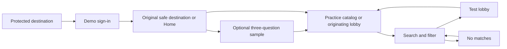
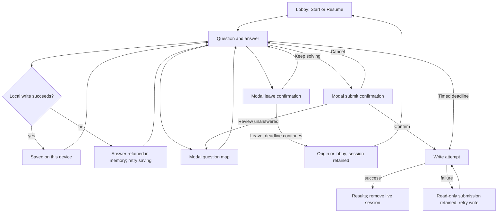
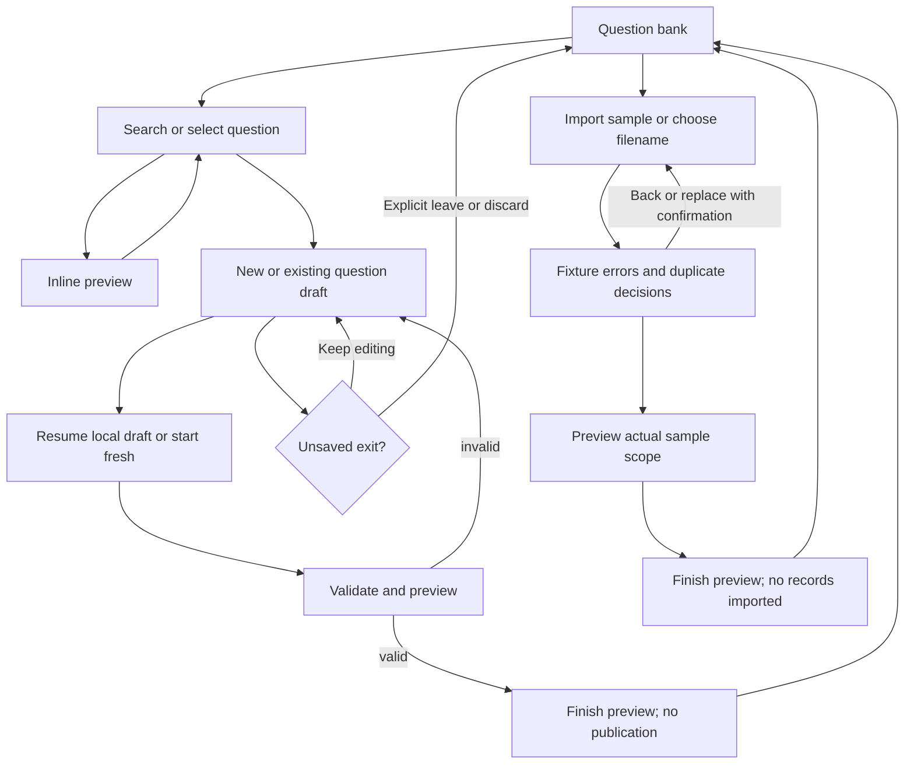

# Primary journeys and exception paths

These are paper walkthroughs of proposed behavior, not executed browser tests. Contract IDs refer to [SCREEN-CONTRACTS.md](SCREEN-CONTRACTS.md); shared navigation and dialog rules are in [NAVIGATION.md](NAVIGATION.md). All primary paths have explicit exit/recovery edges.

## J1 — enter, optionally learn the controls, find a test

1. S01 names the platform purpose and local demo before asking for a phone. Continue validates nine digits; the code step explains that six digits unlock the local preview. Change number returns with the phone retained; Back from code does not lose the number. No SMS/resend promises.
2. Successful sign-in returns to the safe original internal route, including its query/hash; absent context goes to S02. Invalid or external targets use Home. New Home has no fabricated attempts or identity.
3. Home leads with one action: Resume an actual active attempt, otherwise Try a sample for a learner who has not completed it, otherwise Find a practice test. Learners can skip the sample through a visible Browse tests link. Sample Back/Skip never forces completion or creates an attempt.
4. S03 sample selection/checking/map/written example teaches the same action order as exam. Completion returns an originating lobby if there was one, otherwise practice catalog. Profile can reopen the sample later. Reload may restart this unsaved sample and clearly has no scored history to lose.
5. S04 shows mode before topic/search, matching visible translated titles. No matches retains filters and offers Clear filters. No available learning content offers the sample and identified interface previews, not fabricated ready tests.
6. S05 states the actual question types/count, Karakalpak material language, timer and device-local saving. Start creates one session; Resume uses the existing one. Incomplete sets say Open preview; missing definitions say Unavailable with Back to tests. Back restores known catalog context or Home origin.

Paper gate: a first-time learner can reach a sample or practice lobby without a teacher action, existing history, or a mandatory tour. Unknown test has catalog recovery; auth context, sample cancel and empty search have defined destinations.

## J2 — answer, leave/resume and submit a practice or timed exam

S06 always groups prompt and answers in reading order. Choice selection remains editable; repeated selection keeps it, Clear removes it. In practice, Check answer reveals feedback and locks that question; Next follows checking, while Skip is explicitly available when unanswered. Written answer entry preserves Karakalpak characters. Timed mode never reveals correctness before submission. Question position and answered count remain separate.

The modal map names question types/statuses without assuming written questions occupy a suffix. Choosing a question closes the map and focuses its heading. Closing by Escape returns to the trigger without changing question. Finish remains discoverable throughout; do not make Next implicitly submit without confirmation.

Leaving uses a confirmation explaining the timer and device-local state. Keep solving leaves everything intact. Confirmed leave returns to the known entry point or lobby; revisit offers Resume. Unsaved answers add an explicit warning and Retry saving/Leave anyway choices. Browser Back uses the same guard; page close/reload can only use a native warning where supported. No interface can guarantee saving after the page is closed.

Manual submit shows answered/unanswered counts and written-review implications. Review unanswered opens the map. Confirmation creates one attempt, preserves answers, commits before dropping live state, then replaces the live exam route with S07. At zero time, freeze answer changes, close competing overlays and submit once without confirmation; the original deadline and duration cap apply. Save failure leaves a visible retry state and must not claim a stored result. Handling partial writes without duplicate attempts is a stage-5 implementation requirement.

If the test disappears, show unavailable recovery without overwriting the retained session. If only a session is absent, go to the known test's lobby state; do not silently start the timer. Incomplete-but-known content remains an identified preview through lobby, exam and result. Cross-device recovery is not available.

Paper gate: normal, reload, leave/cancel, resume, offline, unanswered, expired and failed-save paths retain a clear task/status/next step. Deadline semantics and grading meanings remain unchanged.

## J3 — understand the result, review and retry

S07 starts with Final result or Preliminary result, followed by correct/incorrect/unanswered/awaiting-review counts. The existing percentage formula is retained; a preliminary score is labeled consistently wherever displayed. Final averages/trends exclude pending attempts. In this local demo, teacher fixture grading does not change student attempts; copy cannot promise a later live grade notification.

The main action is Review mistakes when incorrect/unanswered rows exist; otherwise Review answers. If only pending responses need attention, Review written answers opens the first pending row. These are mutually exclusive choices for one main action. Home and return-to-progress are quieter navigation; Retake goes to an existing active session through lobby/Resume, or a new lobby when none exists. It never resets an active session automatically.

S08 presents prompt → learner answer → expected/accepted answer → explanation → navigation. First/last boundaries disable Previous/Next and explain position; Results restores the attempt's filters/scroll. Missing explanation is “No explanation provided”; manual-only questions have no invented model answer. Save for practice toggles a saved question without leaving Review or changing verdict.

S09 lists only saved IDs and says so. Practice this question opens an inline unanswered retry. Choices/accepted answer remain hidden until Check answer or explicit Reveal; written manual-only retry explains that no model answer exists and does not pretend to send it to a teacher. Close/remove leaves the stored attempt untouched. Empty saved list offers Browse tests and explains how to save from Review.

S10 opens actual attempt rows in S07. Pending rows remain preliminary; historical seed rows without real answers are labeled demo summaries with no broken review link. Empty mode filter offers reset; truly empty history offers Find a practice test. Invalid attempt has Back to progress; invalid review number has Back to this result. Deleted/missing saved question is reported as unavailable and removable rather than silently omitted.

Paper gate: the learner can distinguish pending versus final, find a review explanation, deliberately reveal a retry answer and return to a meaningful origin without affecting earlier results.

## J4 — change preferences, sign out and recover access

S11 groups identity, language, appearance and local-data scope. Language/theme/transparency changes preserve current saved sessions and attempts. Unsupported/blocked storage produces truthful unsaved-preference feedback rather than a false success. Text/content language remain distinct; changing UI language does not translate legal material.

Reopen sample returns with a known Profile origin. Sign out is a secondary action; if active attempts exist, first explain that sign-out does not stop a timed deadline and saved data stays on this browser. Keep signed in cancels. Sign out clears auth under the existing model; later demo sign-in can access existing browser-local data, so do not imply per-account secure isolation. Do not add a destructive reset to ordinary student navigation.

Direct protected links enter S01 and return after sign-in. Missing auth data falls back safely; missing attempt/test recovery follows J1/J3. Unknown routes show a named not-found state with Home. The workflow adds no production role or security guarantee.

Paper gate: preference change, canceled sign-out, confirmed sign-out and direct-link re-entry all have clear destinations and honest storage/timer boundaries.

## J5 — find/edit a question or inspect an import

T01 Overview opens T02 Bank. Search/filters have a visible scope/count; zero matches keeps controls and offers Clear filters. Selection names visible scope and remains separate from Open preview. Preview begins closed; opening/closing the inline panel does not block the table or expose answers to students. New question opens T03; Edit opens T04 with known question context and Bank return state.

Editor flow: choose choice/written → prompt/content → answer key or accepted/manual grading → validate → inline preview. Only one correct choice can be selected. Invalid fields retain values and receive an error summary/first-error focus on explicit validation. Preview matches exam reading order; changing type with populated incompatible fields requires confirmation before discarding them.

Current editor operations are previews/session-only. The stage-7 contract adds recoverable local drafts, independently of publication: entering a matching route offers Resume draft/Start fresh; successful writes show Draft saved on this device, failed writes retain input and offer Retry saving. Primary task action is Check and preview, then Finish preview when valid; no Published claim. Cancel, Bank, teacher navigation and browser Back guard unsaved changes with Keep editing/Leave anyway (or deliberate Discard draft); canceling retains every field. Successfully saved local drafts remain recoverable on return/reload. Reload/close of unsaved work warns with native limitations. A missing edit ID gives Back to bank/Create new rather than fake edit mode. Publishing into the live bank is outside the data boundary.

Import branch: Bank → T05 Upload/sample → fixture validation → preview → Finish preview → Bank. Choosing a filename is not parsing Excel; explain this before choosing it. Show row errors, warning decisions and duplicate handling with their sample scope. Next can inspect an error-containing sample but cannot say Ready to import or commit it to the real bank. Back preserves decisions; replacement input warns before resetting them. Saved preview metadata can restore compatible sample decisions, never file bytes or parsed rows. Cancel with unsaved decisions uses the dirty guard. No file chosen offers Use sample; unavailable schema/template uses inline guidance rather than a nonexistent download.

Paper gate: edit validation, dirty cancel, invalid ID, empty bank, replacement import, error rows and preview completion all have explicit paths without a false persistence promise.

## J6 — assemble a test preview

T06 keeps four steps: Details/mode → Questions → Groups/dates → Review. Step Back retains values and does not exit. Step Next validates only relevant required fields; all errors remain near their fields with a summary when blocked. Automatic planning respects the current supported count rules; manual selection requires a nonempty valid set. Do not imply 45 questions were selected in manual mode when the sample contains fewer.

Question search with no matches offers reset and preserves selection. Switching selection method keeps each method's draft until the teacher deliberately resets it. Known unavailable questions are flagged and excluded from a new valid selection, without silently changing an existing exam attempt. Group/date validation rejects end-before-start and clearly separates date availability from per-attempt timer duration. No available real groups means a labeled sample selector, not invented enrollment.

Review lists the actual mode, count/types, timer, selected sample groups/dates and settings. Finish preview goes to Overview and explicitly says no test was published or assigned; saving a local draft is a separate outcome. Teacher Cancel/Back to overview/browser Back guards unsaved changes. Stage 7 must add Resume local draft on return and restore successfully saved fields across reload; current session-only behavior does not satisfy that requirement. Failed writes retain the in-memory draft and offer retry. The proposed additive draft policy is specified in Navigation for this stage's review.

Paper gate: automatic/manual selection, zero search results, bad counts/dates, backtracking, cancel/keep/discard and truthful completion are specified.

## J7 — review written work, inspect a student and investigate an issue

T01 opens T07 Grading with queue/response/action regions. Choose a pending fixture response; read answer and rubric/model when available; enter comment; choose correct/partial/incorrect; Apply sample grade advances to another pending response and enables a real local Undo. Changes are session-only and do not update S07. Editing comments/grade selection is dirty until applied or explicitly discarded; navigation and queue selection guard that draft. Empty queue says No sample responses awaiting review and links to Overview; all-done state can review graded fixture items without inventing new ones.

Keyboard grading shortcuts remain guarded while typing and during modal dialogs. Undo restores the exact previous local grade, queue position and associated applied state; if a specific operation cannot be reversed, no Undo is offered. Save/apply feedback names the sample scope. Reload discards applied session-only changes under the stated policy.

T08 Students combines list/filter and selected details. Selection stays within the filtered list; removing the selected item through filtering chooses a valid visible row or clears detail. No matches clears stale detail and offers Clear filters. Attempt data is labeled sample; actual routable attempts may link only when available in the local student store. Do not construct IDs that lead to another learner's current result. Assignment action is View assignment preview under current capabilities.

T09 Analytics prioritizes a named question issue and its sample response distribution before technical coefficients. Data alternatives expose the same values. Inspect row/question leads to Bank/Editor using valid IDs and a safe return context. A supported local sample adjustment can name its effect; actual bulk regrade is unavailable without connected attempts. If a preview of scope is shown, its main action is Close preview and it must not claim students were regraded. Any later supported destructive/bulk regrade needs scoped confirmation and error/partial-success handling before release.

Paper gate: grading draft cancel/apply/undo, no queue, empty student filters, stale-selection recovery, unknown linked question and unavailable regrade all have clear states. Cross-role consistency is an integration dependency, not a fabricated frontend result.
