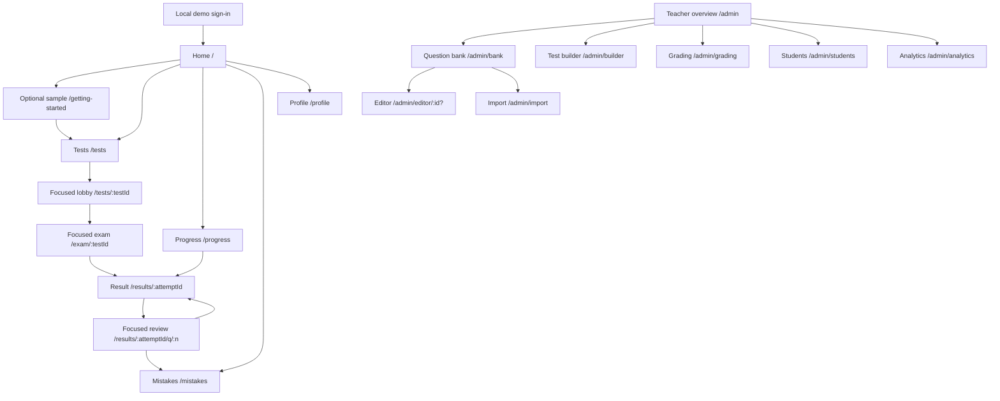

# Navigation and shared behavior contract

This document specifies proposed behavior for later implementation. Current behavior and defects are recorded in [stage 0](../stage-0/README.md). The route paths and existing `hm.*` records remain compatible.

## Destination map

Arrows show task transitions, not new menu items or a claim of shared backend data. All student shell pages expose the five destinations. Teacher shell pages expose all seven teacher destinations. `/design` remains a directly accessible internal reference outside normal navigation. Teacher access remains the existing demo access model; adding production authorization is separate work. Teacher navigation retains an explicit Student app link to `/`; do not add teacher/design shortcuts to the student Profile.

## Student labels and selection

Keep the existing localized destination wording rather than introducing an unreviewed replacement. These entries are copied from `src/i18n/messages.ts`, not newly language-reviewed translations.

| Destination / path | Uzbek | Karakalpak | Russian | Selected for |
|---|---|---|---|---|
| Home `/` | Bosh sahifa | Bas bet | Главная | `/`, `/getting-started` |
| Tests `/tests` | Testlar | Testler | Тесты | `/tests`; focused lobby/exam have no persistent menu |
| Progress `/progress` | Natijalar dinamikasi | Nátiyjeler dinamikası | Прогресс | `/progress`, `/results/:attemptId` |
| Mistakes `/mistakes` | Xatolarim | Qátelerim | Мои ошибки | `/mistakes` |
| Profile `/profile` | Profil | Profil | Профиль | `/profile` |

The Mistakes page subtitle explains “Questions you saved for practice.” Its count is the number of saved questions, not the total number of wrong answers. Review offers “Save for practice” / “Remove from saved questions”; incorrect/unanswered/pending remain attempt verdicts. Existing stored IDs are preserved, and retry does not change an earlier attempt's grade.

## Teacher labels and selection

| Group | Destination / path | Selection rule |
|---|---|---|
| — | Overview `/admin` | Exact index only |
| Content | Question bank `/admin/bank` | Bank and both editor variants |
| Content | Import `/admin/import` | Import only; breadcrumb links back to bank |
| Content | Test builder `/admin/builder` | Builder only; distinguishes authoring from student Tests |
| Students | Grading `/admin/grading` | Grading only |
| Students | Students `/admin/students` | Student list/detail |
| Students | Analytics `/admin/analytics` | Analytics only |

Use existing translations for unchanged labels. “Test builder,” “Save for practice,” changed subtitles and status copy need explicit three-language message entries; English phrases in these documents specify meaning, not approved production copy. Group headers are noninteractive labels. Demo badges/totals must be scoped as sample data; do not present static fixture totals as current user work. Queue count must reflect the displayed fixture's unfinished items rather than blindly counting all fixture rows.

## Frames and responsive behavior

| Frame | Routes | Rules |
|---|---|---|
| Entry | `/sign-in` | Brand, purpose, language, demo disclosure, one form action; no student navigation before sign-in |
| Learning | `/`, `/getting-started`, `/tests`, `/progress`, `/mistakes`, `/profile`, `/results/:attemptId` | Five labeled destinations, one main landmark and page title; consistent reading width and feedback location |
| Focused | `/tests/:testId`, `/exam/:testId`, `/results/:attemptId/q/:n` | Named return/exit, title/context, task content and task controls; global navigation excluded |
| Teacher | All known `/admin` pages | Grouped navigation, breadcrumb/page title, work region, task-specific action region; editing remains inside teacher shell |
| Reference | `/design` | Internal reference controls and main landmark; explicitly return Home; no extra student navigation item |

At 1440/1366px, show labeled side navigation. At 1024px prefer a narrower labeled sidebar while retaining readable work space; teacher dense tables may use a labeled navigation drawer instead of an icon-only rail when columns cannot fit. Collapse based on actual content pressure, not a new mobile artboard requirement. At effective narrow widths use one menu trigger opening a modal navigation drawer with all labeled destinations; choose one active navigation representation, not simultaneous sidebar/tabbar landmarks. Selecting a destination closes the drawer, navigates and focuses the page heading. Closed/inactive navigation must not remain tabbable. Focused exam never hides essential actions behind the global menu.

Keep page titles/actions wrapping rather than clipping. Only genuinely two-dimensional tables may have labeled horizontal scroll regions; body text, dialogs and exam answers reflow. Drawer behavior uses the modal contract below. Stage 2 establishes hit areas; stage 3 implements the frames.

## Return context and history

Return context is optional, same-origin route state or existing query parameters, not a change to the persisted attempt/session schema. Validate incoming destinations against this route inventory; reject external/protocol-relative or unrelated return targets. Preserve the full internal pathname, search and hash through sign-in. Reload/direct links use explicit fallbacks if ephemeral route state is absent.

| Transition | Context to preserve | Explicit return / fallback |
|---|---|---|
| Catalog → lobby | Mode, topic, search, list scroll and originating card | Back to tests restores catalog context; fallback `/tests?mode=<actual test mode>` |
| Home → lobby | Selected test; Home origin | Explicit Back home when Home is known origin; direct entry uses Back to tests |
| Lobby → sample | Lobby URL/context; no active session mutation | Back returns lobby; completing sample returns lobby; direct sample completes to `/tests?mode=practice`, Back/Skip home to `/` |
| Home/profile → sample | Safe origin | Skip/back returns origin; completion goes to practice catalog unless origin was lobby; no attempt created |
| Lobby → exam | Existing session or newly created session | Leave test opens confirmation; confirmed leave returns origin lobby when available, else `/tests/:testId`; session retained |
| Home → active exam | Active test and Home origin | Confirmed leave returns `/`; direct exam falls back to its lobby |
| Exam → results | Newly submitted attempt ID | Replace live exam history entry on successful commit; Back must not reopen a submitted attempt as live; explicit Home and review actions remain |
| Progress → results | Mode/filter and attempt row | Back to progress restores context; direct/result-after-submit fallback `/progress`; Home remains secondary |
| Results → review | Attempt, result filter, row, scroll | Results returns same attempt/context; direct review fallback `/results/:attemptId` |
| Review → saved question | Explicit “Open saved questions” link only; Save itself stays in review | `/mistakes`; normal Results link still works |
| Bank → editor | Filters, query, selection, row/scroll | Cancel/Back to bank restores context after dirty guard; direct fallback `/admin/bank` |
| Bank → import | Bank context | Cancel after dirty guard → bank; completion → bank with preview-only summary; direct fallback bank |
| Overview → builder | Overview origin | Cancel/back after dirty guard → `/admin`; step Back never exits |
| Teacher navigation | Current draft state where applicable | Guard dirty draft before changing destination, including Student app; committed/no draft navigates directly |

Browser Back/Forward respects route history rather than redirecting every Back to Home. Guard leaving an active exam or dirty editor/import/builder through browser history as well as in-app links; cancel stays on the same screen/state. Native unload confirmation can warn on close/reload but cannot guarantee recovery or show custom copy. Never trap a learner indefinitely: a confirmed Leave anyway is allowed with a specific loss warning if work is not durably saved. Timed deadlines continue during dialogs, background tabs and navigation.

Catalog mode/topic/search should live in the URL when implemented in stage 4, using the current mode/topic parameters and additive search query state; keep old URLs valid. Other view context may remain ephemeral. Filter changes should replace history within the same task so Back returns to the entry point rather than replaying every keystroke. Stage 1 changes no URLs or storage.

## Overlay and panel decisions

| Surface | Contract | Initial focus / close / return |
|---|---|---|
| Exam and introduction question maps | Modal dialog at every width; map selection is temporary navigation, not another route | Current question cell or first usable cell; Escape/Close returns map trigger; selecting question closes and focuses new question heading |
| Exam exit, submit, failed-save leave | Modal confirmation; irreversible submit clearly named | Focus Keep solving / Review unanswered as appropriate; Escape cancels; no submit by outside click; confirmed route change focuses destination heading |
| Sign-out with active deadline, discard draft, incompatible type/file change | Modal confirmation for an actual loss/running-timer consequence | Safe Keep signed in / Keep editing / Keep current initially; Escape cancels; confirmed action names what is retained and lost |
| Compact global navigation | Modal navigation drawer containing links | Current destination link, otherwise first link; Escape/Close returns trigger; background inert |
| Catalog/bank filters | Inline controls; optional anchored nonmodal filter popover only if needed | Filter trigger uses expanded/controls; Escape closes optional popover and returns trigger; no focus trap or inert background; Tab may leave and dismiss |
| Bank detail preview | Inline named complementary panel, initially closed | Explicit Open preview focuses panel heading; Close returns invoking row button; no role=dialog, scrim or focus trap |
| Editor preview | Inline named preview adjacent to draft, or below it when narrow | Toggle announces expanded state; focus stays on toggle; links follow normal tab order; editable draft remains reachable |
| Student details / grading response | Inline named regions | Selection stays available; a separate Open details action can focus heading at narrow widths; no modal trap |
| Bulk delete/discard/regrade | Modal confirmation when operation exists | Safe Cancel initially; name affected count/scope and actual local-demo effect; no fabricated destructive action/undo |
| Save/error feedback | Inline status or alert, never a dialog solely to announce success | Routine success does not steal focus; urgent failure uses alert and nearby recovery button |

All modal dialogs have an accessible name, `aria-modal=true`, inert/noninteractive background, focus containment, visible Close/Cancel, Escape handling, and restoration to a still-present trigger or logical fallback. Confirmation dialogs require an explicit action or Escape to dismiss; clicking the backdrop does nothing. Map/navigation backdrops may close safely, returning focus to the trigger. No nested maps/confirmations: closing one surface precedes opening the next, with the original trigger retained for final return. A timer reaching zero supersedes an open map/confirmation and enters submission; it never waits for a modal to close or pauses the deadline. Documenting `aria-modal` alone does not implement these guarantees.

## Data, saving and unavailable content

Answers have three honest states: unsaved/in memory, saved on this device after a successful local write, and unable to save. Offline is independent of local-save success. Do not claim synced/secure server persistence. On write failure keep the current answer in memory, show recovery feedback, and let navigation between questions continue without discarding it. Submission must not delete the active session or show a durably saved result until its attempt write succeeds. Expiry still freezes answers at the deadline; if a commit fails, retain a read-only result in memory with a Retry saving action and a loss-on-close warning. Stage 5 must resolve retry/partial-write sequencing under the existing schema; this is not a change to timing or grading rules.

Recoverable local authoring drafts are a stage-7 requirement to address baseline B-02. Proposed additive storage is `hm.authoringDrafts.v1`, independent of existing question definitions, `hm.sessions`, `hm.attempts` and grading. Its scope is question drafts keyed by new/existing question identity, the current builder draft, and import-preview decisions/filename metadata. It must carry a kind, source version, update time and validated payload; do not store actual uploaded file bytes or treat filename metadata as parsed content. This is a proposed future addition for this stage's review, not a store created or a migration executed now.

Entering an authoring route offers Resume local draft or Start fresh/Discard with confirmation when an applicable saved draft exists. Only a successful write permits “Draft saved on this device.” Failed write keeps all fields in memory, shows Retry saving and warns before exit. Reload restores a successfully saved compatible draft; invalid/incompatible drafts are reported and never silently replace source content. Check for a newer draft from another tab before overwriting; preserve the user's in-memory version and ask which version to retain. Preview completion and draft saving are separate: neither publishes questions, assigns tests or changes live attempts. Implement and verify these rules in stage 7, including additive-key compatibility and failed writes, before claiming that draft recovery works. Until implemented, use “Changes in this session” with dirty-exit protection instead of an autosave timestamp. Stage-8 applied sample grades remain session-only and explicitly independent of student grades.

Missing IDs render a named unavailable state inside the appropriate frame rather than silently creating/editing different content. A missing session offers Return to lobby; a known submitted attempt links to its result when identifiable. Missing attempt has Back to progress; invalid question number has Back to this result; missing editor ID offers Back to bank with a separately labeled Create new question link. Unknown top-level paths recover to Home; unknown teacher paths recover to Overview. Do not fabricate replacement questions, scores or user history.

Complete teaching material and placeholder preview are separate availability states. Preserve current demo preview entry with an explicit “Open preview” action for incomplete sets, explain that it is unsuitable as a complete learning assessment, and never silently substitute content or convert an active attempt. Missing definitions disable starting and offer catalog recovery. UI language remains Uzbek/Karakalpak/Russian; question material remains identified as Karakalpak with `lang=kaa`.
