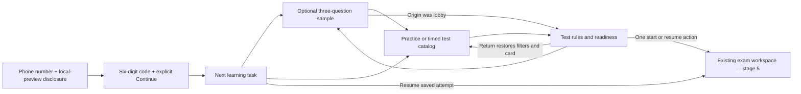

# Entry-to-test prototype

The implemented local pages are the interactive prototype; these checkpoints describe the learner journey and link to captured states. Start Vite as described in README before opening the local links. No production service is connected.

| Checkpoint | Interactive page | Captured composition |
|---|---|---|
| Phone / code | [Sign-in](http://127.0.0.1:5173/sign-in) | [Phone](screenshots/entry-1366-light-ru.png), [code](screenshots/code-1366-light-ru.png), [blocked save](screenshots/entry-storage-error.png) |
| New learner | [Home](http://127.0.0.1:5173/) | [Desktop](screenshots/home-1366-light-ru.png), [active test](screenshots/home-active.png), [returning learner](screenshots/home-returning.png) |
| Optional sample | [Getting started](http://127.0.0.1:5173/getting-started) | [Choice](screenshots/sample-choice.png), [written](screenshots/sample-written.png) |
| Discover intended mode | [Practice catalog](http://127.0.0.1:5173/tests?mode=practice), [timed catalog](http://127.0.0.1:5173/tests?mode=mock) | [Catalog](screenshots/catalog-1366-light-ru.png), [narrow catalog](screenshots/catalog-320-light-ru.png) |
| Read rules before entry | [Practice lobby](http://127.0.0.1:5173/tests/practice-1), [timed preview](http://127.0.0.1:5173/tests/mock-7) | [Practice](screenshots/practice-lobby-1366-light-ru.png), [preview](screenshots/lobby-preview.png), [failed start](screenshots/lobby-save-error.png) |

The dashboard prioritizes a usable saved session, then the optional introduction if incomplete, then practice. It displays actual recent attempts separately and labels pending scores. Static assignment definitions are named sample assignments. Missing saved tests are explained and retained.

Search/mode/topic belong to the URL; filter edits replace history. Opening a test retains the originating catalog URL, card and scroll. The named return restores that context. Direct lobby links use their actual mode as the catalog fallback. Sample completion returns to an originating lobby or the practice catalog; skipping returns to origin without completing the introduction.

Readiness distinguishes complete material, placeholder preview and missing content. Preview labels precede entry, missing content cannot start, and existing sessions are never reset. An expired attempt goes through the existing expiry handler without a renewed deadline. The underlying exam interface and submission/write recovery are stage-5 work.
