# Assessment state and persistence contract

Persisted `ExamSession` and `Attempt` shapes and existing keys remain unchanged. Grading and content definitions remain unchanged. A stable result ID derives from test ID and session start time; legacy attempt IDs remain readable. Submission snapshots and save-status flags are provider memory, not a new storage schema.

```mermaid
stateDiagram-v2
  [*] --> Solving: saved session exists
  Solving --> Saved: answer / position / flag / check write succeeds
  Saved --> Solving: continue
  Solving --> Unsaved: write fails; retain newest snapshot in memory
  Unsaved --> Saved: retry writes current in-memory sessions
  Unsaved --> Unsaved: navigate questions / edit; no answer discarded
  Solving --> ConfirmFinish: explicit finish
  Unsaved --> ConfirmFinish: explicit finish
  ConfirmFinish --> Solving: cancel / review unanswered
  ConfirmFinish --> Frozen: submit
  Solving --> Frozen: absolute deadline expires
  Unsaved --> Frozen: absolute deadline expires
  Frozen --> Waiting: result write fails
  Waiting --> Waiting: keep snapshot read-only; retry allowed
  Waiting --> ResultSaved: retry result write succeeds
  Frozen --> ResultSaved: result write succeeds
  ResultSaved --> CleanupWaiting: removing session fails
  CleanupWaiting --> CleanupWaiting: retry; reuse saved result, no duplicate or overwrite
  CleanupWaiting --> Complete: session removal succeeds
  ResultSaved --> Complete: session removal succeeds
  Complete --> [*]: replace route with results
```

Session writes update memory even on failure; status says unsaved and a native unload warning protects against loss. A successful retry writes the current complete session set. Offline is an independent browser signal; it is never proof of saving or offline-reload support.

At manual submit or expiry, capture one immutable attempt snapshot with existing grading inputs, flags, start/deadline-based duration and stable ID. Save attempts first; do not navigate or delete the session if that write fails. If result saving succeeds but session cleanup fails, retain the frozen workspace and explain that the result itself is saved. On reload, the stable ID identifies the durable result and permits cleanup without writing a second attempt or replacing its answers with an older session snapshot.

If all writes fail, answers and the pending submission exist only in memory. Retry preserves them while the application remains open; a browser close/reload cannot be guaranteed to recover unsaved data. Warn explicitly, attach a native unload guard and permit a confirmed Leave anyway. A manual failed-submit reload can restore only the last successful session write and require confirmation again; an expired deadline always freezes immediately. This limitation is truthful and does not invent persisted fields.

Deadlines are absolute timestamps, recalculated from `Date.now()`. Every mutating event checks the deadline synchronously, so an event between timer ticks cannot add a late answer. Dialogs/background tabs never pause time. Expiry dismisses maps/exit/submit and freezes the snapshot. Announce major time thresholds, not every tick. Existing sessions with no deadline remain untimed.

SPA exits, browser Back/Forward and ordinary exit buttons use the same leave confirmation. Cancel stays on the current question with answers intact; explicit origin or test lobby is the safe return. Native unload warns only when there is unsaved work/pending unsaved submission. Result navigation bypasses the guard only after both writes succeed. One modal surface is open at a time. Map selection focuses the question heading; cancel restores its trigger.

The action sequence is Check answer for an unchecked chosen practice answer, Skip question when empty, Next question after checking or in timed/written work, Review and finish at the end. Global arrows navigate questions without checking; answer-radio arrows retain their local selection behavior. Inputs, editable content, native selects and open dialogs suppress page shortcuts. Flags and checked state persist and remain independent of answered count.
