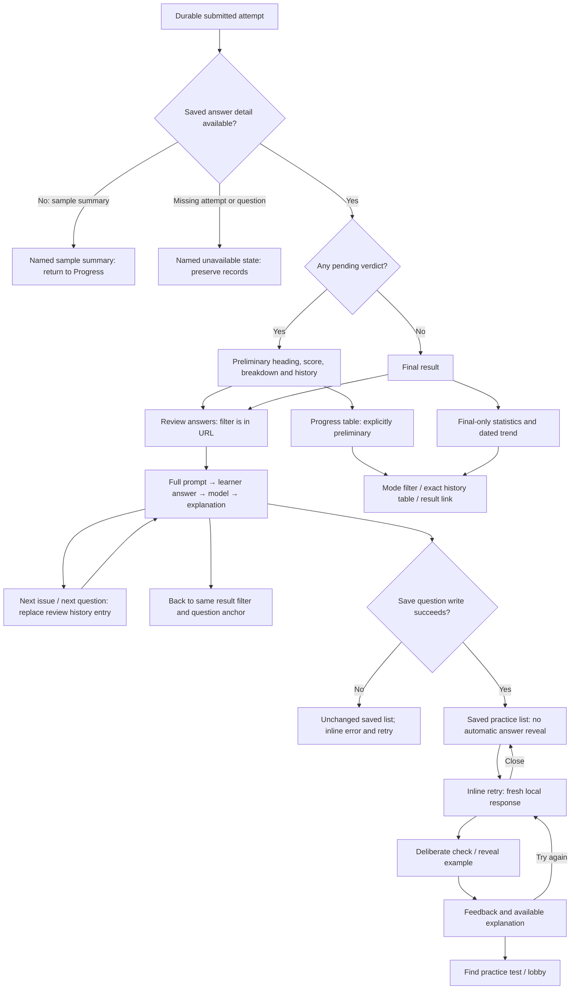

# Learning-loop states and data boundaries

The four verdict counts partition the existing grading rows. The score denominator remains all questions, including unanswered and pending questions; pending is a separate verdict and never merged into incorrect. Results explain that formula. Grading, normalization, question content, attempt answers and session deadlines are unchanged.

Progress averages and best values use all available final, detailed results in the selected mode. The chart shows up to ten of those final results by actual submission date on a 0–100% scale. Pending results, sample summaries and unavailable details remain visible in history but are excluded from final statistics/trends. Sample summaries have no invented review link. Unknown question content offers recovery rather than throwing from grading.

Retry answers/check state live only inside the mounted practice region. Closing/reopening or switching retries resets that practice response. Checks and reveals never modify an attempt, grade, session or deadline. Written exact/near/manual checks use the existing verdict function. No teacher submission is implied; missing models/explanations are stated explicitly. Missing saved IDs stay removable.

## Navigation and focus

Results filters and progress modes use URL query parameters and replace filter history entries. Review return values are restricted to the same attempt's result path. An anchor restores the invoking result row; direct links work without return state. Previous/next review changes replace the current review entry, so browser Back returns to the source result rather than replaying every question. Review keyboard shortcuts respect inputs and browser modifiers through the shared hook. Retry opens with a focused heading; Escape/Close restores its trigger. Removing a saved entry returns focus to the list heading.

## Local preferences and sign-out

Theme/transparency and saved-question writes persist first; failures leave the previous value/list intact. Failed preferences retain an explicit retry action. UI language can change in the current tab even if its preference cannot be persisted; Profile states this and offers retry. Storage keys/schema remain unchanged.

Profile labels the browser-local preview and shared browser records. Active tests or undurable snapshots require sign-out confirmation with Stay signed in initially focused. Saved deadlines continue. An already durable result awaiting session cleanup is not described as unsaved answers. A failed identity removal leaves the learner signed in with an error; successful sign-out retains test records and saved questions in this browser. No account isolation, synchronization or backend grading is added.
